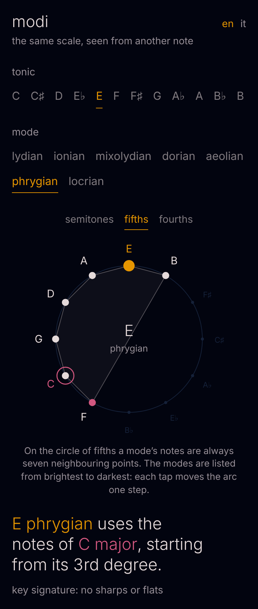

# modi

The same scale, seen from another note.

**[Open modi](https://phonk.github.io/modi/)**

Pick a tonic and a mode, and modi shows you:

- which major scale the mode comes from, and from which degree it starts;
- the note that gives it its colour, in red;
- the twelve-note dial, by semitones, fifths or fourths;
- the key signature;
- the other modes that share the same notes;
- the seven modes on the same tonic, from brightest to darkest.

Tap a note to hear it, or play the whole scale. Notes are spelled correctly, one letter per degree. The interface is in English, with Italian one tap away.

Everything lives in a single file, `index.html`, with no dependencies.

---

**modi** — *la stessa scala, vista da un'altra nota.* Scegli una tonica e un modo per vedere da quale scala maggiore viene, la sua nota di colore, il quadrante delle dodici note per semitoni, quinte o quarte, l'armatura di chiave, i modi fratelli e i sette modi dal più luminoso al più scuro. L'interfaccia è in inglese, con l'italiano a un tocco.

## License

MIT
